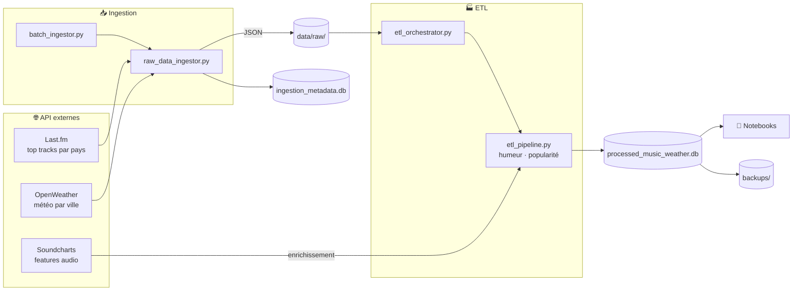

<div align="center">

# 🎵🌦️ WeatherFM

**La météo influence-t-elle ce qu'on écoute ?**

Pipeline de données qui croise les tendances musicales **Last.fm**, la météo **OpenWeather** et les caractéristiques audio **Soundcharts**, ville par ville.


[Démarrage rapide](#-démarrage-rapide) · [Architecture](#-architecture) · [Données](#-modèle-de-données) · [CLI](#-commandes) · [Configuration](#-configuration) · [Limites](#-limites-connues)

</div>

---

## ✨ Fonctionnalités

- **Collecte multi-sources** : trois API sont interrogées (Last.fm pour le top des titres par pays, OpenWeather pour la météo par ville, Soundcharts pour les métadonnées et features audio).
- **Ingestion par batch** : les réponses brutes sont sauvegardées en JSON dans `data/raw/`, avec un journal des tentatives et des rapports de lot.
- **Pipeline ETL** : un orchestrateur gère extraction, transformation et chargement en SQLite. Il classe chaque titre par humeur et calcule un score de popularité. Les titres sont ensuite enrichis via Soundcharts.
- **Monitoring continu** : la collecte tourne en boucle sur un intervalle configurable.
- **Sauvegardes** : les bases SQLite sont copiées dans `backups/`.
- **Analyse** : des notebooks Jupyter servent à évaluer la qualité des données et à explorer les premiers résultats.

---

## 🚀 Démarrage rapide

```bash
# 1. Créer le fichier .env (voir la section Configuration)
# 2. Lancer
./start.sh
```

Le script vérifie que Docker et Docker Compose sont installés et que les clés API sont présentes dans `.env`. Il démarre ensuite les services.

| Service | URL | Accès |
|---|---|---|
| 📓 Jupyter | http://localhost:8888 | token `admin` |
| 🎵 Collecteur | – | `./start.sh logs music-weather-collector` |

Les autres commandes du script :

| Commande | Effet |
|---|---|
| `./start.sh stop` | Arrête les services |
| `./start.sh restart` | Redémarre les services |
| `./start.sh status` | Affiche l'état des conteneurs |
| `./start.sh logs [service]` | Suit les logs |
| `./start.sh test` | Test rapide : collecte sur Paris |

---

## 🏗 Architecture



Le **mode monitoring** (`--monitor`) suit un chemin plus court : `lastfm_weather_collector.py` interroge Last.fm et OpenWeather à chaque cycle, puis écrit directement dans `data/lastfm_weather.db`.

---

## 🗄 Modèle de données

Toutes les bases sont des fichiers SQLite stockés dans `data/`.

| Base | Table | Contenu |
|---|---|---|
| `lastfm_weather.db` | `city_music_trends` | Titre, artiste, listeners, météo, humeur, par ville et horodatage |
| | `daily_stats` | Agrégats quotidiens par ville : température moyenne, humeur dominante, artiste le plus écouté |
| `ingestion_metadata.db` | `ingestion_log` | Journal des tentatives d'ingestion |
| `processed_music_weather.db` | `processed_tracks` | Titres transformés avec météo, humeur et score de popularité |
| | `etl_stats` | Statistiques de chaque exécution ETL |
| | `soundcharts_tracks` | Genres, labels, ISRC et features audio (energy, valence, tempo, danceability…) |

### Règles de transformation

- **Humeur** (`mood_category`) : classement par mots-clés présents dans le titre et le nom de l'artiste. Les catégories sont `happy`, `sad`, `energetic`, `calm`, `romantic` et `neutral` par défaut.
- **Score de popularité** : `min(listeners / 10 000, 1)` + un bonus d'engagement (playcount / listeners × 0,1), plafonné à 0,2.

---

## 💻 Commandes

Depuis la racine du projet, en local :

```bash
python src/main.py --test                    # Test rapide (Paris)
python src/main.py --monitor --interval 3600 # Collecte continue toutes les heures
python src/main.py --ingest-batch            # Ingestion batch de toutes les villes
python src/main.py --ingest-batch --batch-size 2
python src/main.py --run-etl                 # ETL + enrichissement Soundcharts
python src/main.py --cities "Paris,Lyon"     # Override temporaire des villes
python analyze_data_flow.py                  # Rapport sur le flux de données
```

Dans Docker, le collecteur démarre en mode `--monitor`. Pour lancer l'ETL dans le conteneur :

```bash
docker compose exec music-weather-collector python src/main.py --run-etl
```

---

## ⚙️ Configuration

Crée un fichier `.env` à la racine du projet :

```env
# Clés API (obligatoires)
LASTFM_API_KEY=votre_cle_lastfm_ici
OPENWEATHER_API_KEY=votre_cle_openweather_ici
SOUNDCHART_API_KEY=votre_cle_soundcharts_ici
SOUNDCHART_APP_ID=votre_app_id_soundcharts_ici

# Villes suivies (listes alignées, séparées par des virgules)
CITIES=Paris,Nice,London
COUNTRIES=France,France,United Kingdom

# Paramètres de collecte
COLLECTION_INTERVAL=3600
MAX_RETRIES=3
RATE_LIMIT_DELAY=1.0
INGESTION_DELAY=2.0
DB_BACKUP_DIR=data/backup
```

Pour obtenir les clés :
- **Last.fm** : https://www.last.fm/api/account/create
- **OpenWeather** : https://openweathermap.org/api
- **Soundcharts** : https://soundcharts.com/api

---

## 📁 Structure du projet

```
WeatherFM/
├── docker-compose.yaml          # Collecteur + Jupyter
├── Dockerfile                   # Image Python 3.9-slim
├── start.sh                     # Script de démarrage et de gestion
├── requirements.txt
├── analyze_data_flow.py         # Rapport sur le flux de données
│
├── src/
│   ├── main.py                  # Point d'entrée CLI
│   ├── lastfm_weather_collector.py  # Collecte Last.fm + météo, monitoring
│   ├── database.py              # Gestion SQLite
│   ├── data_analyzer.py         # Insights rapides
│   ├── visualizer.py
│   ├── ingestion/
│   │   ├── batch_ingestor.py    # Ingestion par lot de villes
│   │   └── raw_data_ingestor.py # Appels API + sauvegarde JSON brut
│   ├── etl/
│   │   ├── etl_orchestrator.py  # Pilotage ETL + Soundcharts
│   │   └── etl_pipeline.py      # Extract / Transform / Load
│   └── utils/
│       ├── helpers.py           # Config, sauvegardes, validation .env
│       └── logger.py
│
├── notebooks/
│   ├── data_analysis.ipynb      # Exploration des résultats
│   └── data_quality.ipynb       # Qualité des données
│
└── data/                        # Généré à l'exécution (non versionné)
    ├── raw/                     # JSON bruts
    ├── ingestion_reports/       # Rapports de lot
    ├── failed_ingestions/       # Ingestions en échec
    └── *.db                     # Bases SQLite
```

---
